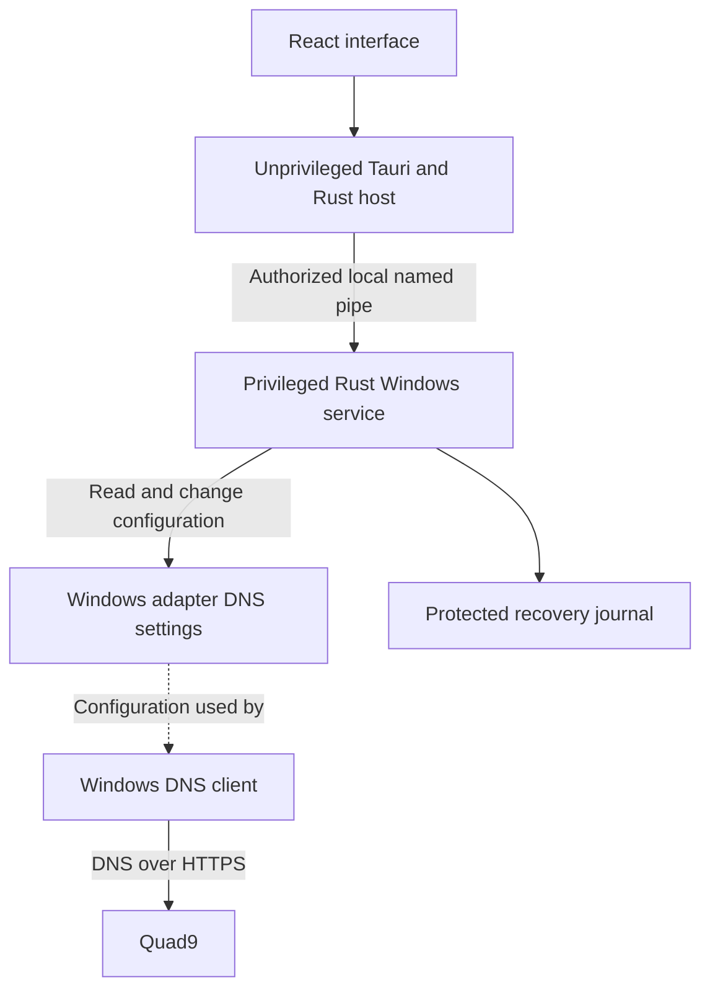

# Quad9 Connect for Windows project specification

Specification version 1.0. Final implementation baseline, 19 October 2026.

Quad9 Connect for Windows is an independent community desktop application that makes encrypted Quad9 DNS easy to enable, verify, and undo. It uses the repository name `quad9-connect-windows` and takes its product direction from Quad9 Connect for Android.

The first release configures the native Windows DNS client. A later release can add a local forwarding service for observed DNS activity. The application must remain useful with a compact interface and tray controls, and must preserve the user's ability to restore their previous DNS configuration.

This specification describes required behavior. Version 0.1 implementation is underway. The [implementation status](implementation-status.md) distinguishes completed foundations from release requirements still awaiting implementation or Windows VM validation.

## Product goals

- Enable encrypted Quad9 DNS without requiring users to edit adapter settings themselves.
- Show what was configured and what a diagnostic actually verified.
- Restore previous DNS settings accurately, including static configurations.
- Stay usable through network changes, application crashes, upgrades, and removal.
- Provide a polished Windows utility with low background resource use.
- Keep normal operation local, with no account, cloud backend, or telemetry requirement.

The intended first audience is individuals using Windows 11 on home and personal networks. Managed enterprise deployment and broad VPN integration require separate compatibility work.

## Fixed product decisions

| Area | Decision |
| --- | --- |
| Product name | Quad9 Connect for Windows |
| Repository | `quad9-connect-windows` |
| Initial platform | Windows 11 x64. Publish the exact tested Windows builds with each release. |
| Other platforms | Windows 10, Windows Server, and ARM64 are outside the initial support commitment. |
| Desktop stack | Tauri 2, React, TypeScript, and Vite |
| Styling | Tailwind CSS and selected shadcn/ui components, with a compact custom layout |
| Native integration | Rust using Microsoft's Windows API bindings |
| Privileged component | A separate Rust Windows service managed by the Service Control Manager |
| Communication | Narrow Tauri commands and an access-controlled local named pipe |
| Initial DNS engine | The native Windows DNS client, configured for DoH |
| Default resolver | Quad9 with threat blocking and without ECS |
| Encryption policy | Encrypted DNS required. No automatic plaintext or alternate-provider fallback. |
| Storage | Versioned local files for preferences, configuration snapshots, and recovery state |
| Distribution | A Windows NSIS installer with explicit service installation and removal hooks |
| Updates | Installer-based upgrades initially. An automatic updater requires its own tested design. |

Use supported stable dependencies and commit their lockfiles when implementation begins. Tauri provides the required [tray APIs](https://v2.tauri.app/learn/system-tray/) and [Windows installer tooling](https://v2.tauri.app/distribute/windows-installer/). Service lifecycle hooks remain project implementation work.

## Release scope

These milestones define scope and release gates, without delivery estimates.

| Release | Required capability | Gate |
| --- | --- | --- |
| 0.1 Core Windows utility | Native DoH configuration, adapter selection, enable and restore, protected snapshots, connection verification, tray controls, themes, basic diagnostics, and installer lifecycle | Configuration changes are reversible, interrupted operations recover, and status accurately reflects the observed state. |
| 0.2 Network behavior | Timed pause, explicit network rules, supported local-domain routing, policy diagnostics, and a previewable support export | Network transitions, pause expiry, and existing policies behave predictably with the UI closed. |
| 0.3 Observed DNS activity | One selected forwarding engine, optional query capture, result classification, statistics, and notification controls | Only observed requests populate activity views, and forwarding failures have a tested recovery path. |
| 1.0 Supported public release | Accessibility, signed distribution, update recovery, compatibility documentation, performance measurements, and complete user and contributor documentation | All applicable acceptance scenarios pass on the published support matrix. |

Version 0.1 has one native configuration engine. Do not build a second complete forwarding engine alongside it. Keep the service contract independent of the engine so future work can reuse the UI and recovery components.

Per-application exclusions, blocklist subscriptions, advanced transports, and additional Quad9 profiles remain separately evaluated extensions. They are not requirements for 1.0.

## Android baseline and Windows direction

The Android application creates a split VPN with `VpnService`. Its published feature list includes DoT or UDP, query logs, trusted networks, blocked-query notifications, local domains, and excluded applications. Windows will use a different mechanism for the first release. See the [upstream Android project](https://github.com/Quad9DNS/quad9-connect) and the [1.2.4 release](https://github.com/Quad9DNS/quad9-connect/releases/tag/1.2.4) used by the original research.

| Android capability | Windows product decision |
| --- | --- |
| Encrypted DNS transport | Native DoH in 0.1. No VPN tunnel or local DNS listener is required for this stage. |
| Query logs | Introduce in 0.3 through a forwarding engine. Native adapter configuration alone does not supply this data. |
| Trusted networks | Add explicit network behavior rules in 0.2, with visible consequences when Quad9 is paused. |
| Blocked-query notifications | Add only when the forwarding engine can identify a block from an observed response. |
| Local domains | Add supported namespace routing in 0.2 after validating Windows policy and encrypted-DNS interactions. |
| Excluded applications | Require a separate attribution and routing prototype before scheduling implementation. |

Windows-specific priorities are conflict-aware restore, clear diagnostics, reliable installation and removal, and independent controls for the service and application window. Do not market the native releases as complete Android feature parity.

## Architecture



Normal DNS requests do not travel through the React interface, Tauri host, or configuration service. Closing the interface or restarting the service must not remove a committed native DNS configuration.

| Component | Responsibility |
| --- | --- |
| React interface | Display service state, collect preferences, and explain actions and failures. |
| Tauri host | Own the tray, window lifecycle, native notifications, and typed service communication. |
| Windows service | Authorize requests, serialize changes, manage snapshots and timers, inspect adapters, and execute recovery. |
| Windows integration module | Wrap DNS configuration and network notification APIs behind a testable interface. |
| Recovery module | Track transaction progress and determine which settings remain safe to restore. |
| Diagnostics module | Keep system-resolver verification separate from direct upstream reachability. |

Use `GetInterfaceDnsSettings` and `SetInterfaceDnsSettings` with the supported DNS settings structures. Microsoft's [per-interface settings documentation](https://learn.microsoft.com/en-us/windows/win32/api/netioapi/ns-netioapi-dns_interface_settings3) describes DoH properties and separate IPv4 and IPv6 settings. The [setter documentation](https://learn.microsoft.com/en-us/windows/win32/api/netioapi/nf-netioapi-setinterfacednssettings) requires explicit flags for the fields being changed.

Before UI implementation, prove configuration, readback, strict encryption, and exact restoration on the intended Windows builds. Detect required capabilities at runtime and reject unsupported operations before making changes. Document how automatic DNS assignment is distinguished from static settings, rather than inferring the original mode from effective server addresses alone.

## Privilege and service contract

The UI runs without elevation. Installation grants the service the rights required to change DNS. Use a dedicated service identity if it supports every required operation; otherwise use LocalSystem with the narrowly defined command contract below.

The installer creates a local operators group and enrolls the user explicitly selected during installation. Only that group, administrators, and the service identity may control the service. Group membership grants control over the app's machine-wide DNS changes. Do not authorize all authenticated users by default.

The pipe must reject remote clients and authorize each connection using its Windows token. Validate message versions, sizes, adapter identifiers, and operation parameters in the service. Protect against pipe impersonation and reject a server whose identity cannot be verified. Tauri permissions do not replace service authorization.

| Command | Purpose |
| --- | --- |
| `GetStatus` | Return observed configuration, requested mode, pending recovery, and verification results. |
| `ListAdapters` | Return eligible adapters and reasons for excluded adapters. |
| `EnableQuad9` | Apply the fixed profile to explicitly selected eligible adapters. |
| `RestorePreviousSettings` | Restore settings still owned by the app. |
| `RunDiagnostics` | Run bounded checks and return individual results. |
| `PauseUntil` | From 0.2, restore settings temporarily and persist the resume condition. |
| `Resume` | From 0.2, reapply only after checking for changes made during the pause. |

Use typed requests, structured errors, request identifiers, and a versioned protocol. Serialize all configuration mutations. Retrying a request must not repeat a completed mutation or replace the original restore snapshot.

The service accepts fixed profiles and validated identifiers. It must not accept arbitrary shell commands, PowerShell, registry paths, executable paths, or client-selected recovery file paths. Install executables and recovery files where ordinary users cannot modify them. Restrict frontend capabilities and load bundled application content.

## DNS configuration

Version 0.1 exposes one profile, named "Quad9 with threat blocking".

| Setting | Value |
| --- | --- |
| IPv4 servers | `9.9.9.9`, `149.112.112.112` |
| IPv6 servers | `2620:fe::fe`, `2620:fe::9` |
| DoH template | `https://dns.quad9.net/dns-query` |
| Threat blocking | Enabled through the selected Quad9 service |
| ECS | Disabled through the selected Quad9 service |
| Plaintext fallback | Disabled |

These addresses and IPv6 precautions follow [Quad9's Windows 11 setup guide](https://docs.quad9.net/Setup_Guides/Windows/Windows_11_%28Encrypted%29/). The service must apply encryption properties to every configured server in each managed address family. Microsoft's [DoH server settings](https://learn.microsoft.com/en-us/windows/win32/api/netioapi/ns-netioapi-dns_doh_server_settings) expose the plaintext fallback flag; leave that permission unset.

Configure IPv6 only where the adapter has usable IPv6 connectivity. Inspect both address families before reporting success. If an existing resolver path cannot be safely managed, explain the limitation and withhold a claim of complete coverage.

Do not disable IPv6, replace routes, change DNS suffixes, or alter unrelated registration and name-resolution settings. A subsequent Quad9 outage must not trigger an automatic switch to another provider or plaintext DNS.

## Enable and restore transaction

Every change is a durable transaction. The application must preserve the original baseline across repeated enable requests and later restarts.

1. Inspect the selected adapters, current DNS modes, encryption settings, and relevant policies. Reject an operation that cannot be safely reversed.
2. Save a protected snapshot and transaction intent before the first write. Use atomic replacement and durable persistence for recovery records.
3. Recheck the observed settings against the saved baseline. Stop if another actor changed them.
4. Apply only the required fields, recording progress for each adapter and address family.
5. Read the settings back and run a fresh system-resolver verification within a bounded timeout.
6. Commit only when configuration and initial verification succeed. Otherwise restore the app's partial changes where ownership checks permit it.

The snapshot must include the adapter GUID, address family, automatic or static assignment mode, static values and ordering where applicable, relevant encryption properties, original values, last app-written values, schema version, and transaction state. An adapter name or interface index alone is not a stable identity.

For an automatic configuration, restoration returns the assignment mode to automatic so Windows can obtain the current network's DNS settings. It does not restore a stale list learned from a previous DHCP lease.

Compare current values with the last values written by the app before restoring them. Preserve later administrator, VPN, or other application changes. Recheck immediately before each write and verify afterward. Windows configuration calls do not make the whole transaction atomic, so unexpected interference must produce a conflict state and stop further writes.

Restore across all affected adapters and families. If any restoration remains pending, the app must report "Recovery required" or "Settings changed elsewhere", with the affected adapter identified. It must not report "Off" after a partial restore.

On service startup, reconcile unfinished transactions before accepting new mutations. Recover only values the journal identifies as owned by the app. Retain records for temporarily absent adapters. A missing or corrupt journal must never cause a blanket reset to DHCP.

Persist the requested mode alongside the recovery state. After a Windows restart, verify a matching committed configuration without replacing its original snapshot. If observed settings differ, report the conflict instead of treating saved intent as permission to overwrite newer settings.

Keep the journal until every owned change has been restored or explicitly resolved. The service must perform recovery without requiring the UI to be open.

## Connection state and verification

Track requested mode, observed configuration, operation progress, verification evidence, and recovery state separately. A successful button click or API return is not sufficient evidence of an encrypted connection.

| Displayed state | Required evidence or condition |
| --- | --- |
| Off | No unresolved app-owned DNS changes remain. Existing Quad9 settings outside the app's ownership can still be reported separately. |
| Setting up Quad9 | A configuration transaction is in progress. |
| Checking connection | Configuration readback passed and a fresh verification is pending. |
| Encrypted Quad9 verified | Selected settings match, a fresh system lookup reports DoH, and no unresolved scope conflict is detected. Show which network and adapters were checked. |
| Could not verify | Configuration exists, but the check failed, expired, or became stale. |
| Settings changed elsewhere | Observed values or policy differ from the app's expected state. |
| Recovery required | Some owned changes could not be safely restored. |
| Service unavailable | The UI cannot obtain current service state. Preserve the last result as historical information only. |
| Paused | From 0.2, restoration succeeded and a resume condition is recorded. |

Use a fresh TXT lookup of `proto.on.quad9.net.` through the Windows system resolver. A `doh` response is evidence for that lookup. Keep its timestamp and network context. Avoid a cached response without flushing the entire system DNS cache. Quad9 documents this [protocol test](https://docs.quad9.net/FAQs/#protocol-test-confirm-on-which-protocol-quad9-received-your-query).

Invalidate successful verification after relevant adapter, address, routing, DNS policy, or resume events. Rerun checks with debounce and backoff. The first-release check has a 15-second deadline and a separate direct-reachability result. Direct HTTPS access to Quad9 cannot substitute for a system-resolver result.

Verification does not prove that every application uses Windows DNS. Browser encrypted DNS, VPN resolvers, and application-specific DNS can follow other paths, as described in [Quad9's Windows guidance](https://docs.quad9.net/Setup_Guides/Windows/Windows_11_%28Encrypted%29/). On multiple active adapters, distinguish configuration checks from the path used by the test. Withhold a broad verified state when the effective scope is ambiguous.

After a previously committed setup becomes unreachable, preserve the chosen encryption policy, show the failure, and offer restore or an explicit pause when available. Do not silently reduce protection.

## Interface and tray behavior

Use a compact utility window, initially around 480 by 640 logical pixels, with scrolling when text size or display scaling requires it. The connection screen is the primary view. Settings and diagnostics are secondary views. Avoid graphs, threat counters, and decorative dashboards in native releases.

The connection screen shows the current state, a plain-language explanation, selected adapters, profile, last verification time, and one primary action. "Enable Quad9" changes to "Turn off and restore DNS" when the app owns a configuration. Show operation progress and prevent conflicting actions while a transaction runs. Failures must explain the affected adapter and the available next action.

Settings contain adapter selection, theme, application startup preferences, and connection notification preferences. From 0.2 they also contain network rules and local-domain settings. Hide unimplemented controls instead of presenting placeholders.

Use light, dark, and system themes, with system as the default. Support Windows high contrast, keyboard navigation, visible focus, screen-reader labels, reduced motion, and 200 percent display scaling. Status must remain understandable without color. Use restrained transitions and no continuous idle animation.

Use the exact official Quad9 icon assets requested for the project. Preserve their proportions and keep status text and indicators separate from the logo. Record asset provenance and applicable terms before public distribution. Quad9 provides a [media kit](https://quad9.net/news/media-kit/).

The 0.1 tray menu contains:

```text
Quad9 Connect for Windows
<Current connection state>

Open application
Run diagnostics
Settings

Turn off and restore DNS
Quit interface
```

In 0.2, add "Pause for..." with 5 minutes, 15 minutes, 1 hour, and until Windows restarts, plus "Resume now" while paused. Enable menu actions according to service state. Use the same state and commands as the main window.

Left click opens the application and right click opens the menu. Closing the window hides it and keeps the tray available. "Quit interface" removes the tray and UI process while leaving the service and DNS configuration running. Explain this on first use. Reopening the app attaches to the existing service and does not create a second controller.

Keep service startup independent of interface startup. The installed service starts automatically for recovery and saved intent; that does not itself authorize first-time DNS changes. An administrator action to disable service startup must first resolve active management, pending recovery, and pause timers. On first installation, DNS management remains off until the user selects adapters and enables it. Opening the window at sign-in defaults to off. A user may separately opt into starting the interface minimized to the tray.

Connection warnings must be actionable, respect notification preferences, and avoid repeated identical alerts. Native releases do not emit "Threat blocked" notifications.

## Adapter and network behavior

Version 0.1 offers physical Wi-Fi and Ethernet adapters after checking their capabilities and policy context. Show the proposed scope before enabling. Do not automatically enroll new adapters. Keep exclusions visible with a reason, including VPN, Hyper-V, WSL, Docker, loopback, tunnel, and unsupported virtual adapters.

Observe network changes from the service. Debounce repeated notifications, re-read state, invalidate old verification, and verify again when appropriate. Detection and accurate status are 0.1 requirements; user-defined network automation arrives in 0.2.

Do not automatically rewrite VPN DNS or defeat policy-managed settings. If a policy or VPN interferes, explain the affected scope and preserve the external configuration. Universal VPN compatibility is not a release claim.

Version 0.2 network rules must be explicit and opt-in. A display name or Wi-Fi SSID alone is insufficient evidence that a network is trusted. Show how a rule matched and offer a temporary manual pause for captive-portal sign-in. Do not automatically bypass Quad9 based only on portal detection.

Timed pauses belong to the service. Persist their deadline or Windows boot condition. A service restart is not a Windows restart. On resume from sleep, process an expired deadline promptly. Before reapplying, compare the current settings with the restored baseline and preserve any changes made during the pause.

## Local-domain routing

Version 0.2 may use the Windows Name Resolution Policy Table for supported namespace rules. The implementation must prove compatibility with the chosen native DoH settings before exposing this feature. A namespace policy is a routing rule and must not be labeled as a harmless website allowlist. Microsoft documents namespace policies through [Add-DnsClientNrptRule](https://learn.microsoft.com/en-us/powershell/module/dnsclient/add-dnsclientnrptrule).

Each rule shows the domain scope, whether subdomains are included, the destination resolver, and the reason for the exception. Normalize and validate names before use. Preserve existing administrator rules and identify app-owned rules independently so only those rules are removed on restore or uninstall.

Use the appropriate original network resolver for local exceptions and refresh it after network changes. Do not forward private names to arbitrary public resolvers when local DNS is unavailable. Explain when a local exception uses a resolver path without DoH, and scope encrypted-status wording accordingly.

## Diagnostics and privacy

Diagnostics report separate outcomes for adapter settings, system resolver and transport, direct Quad9 reachability, service health, recovery state, and relevant policy conflicts. Version 0.2 adds tests for configured local domains and support export. A timed probe may show its own duration, labeled as a diagnostic measurement.

Preferences are stored per user. Recovery state and operational journals belong to the service in an access-restricted machine directory. Version all persisted formats and preserve readable rollback data through upgrades.

Native releases do not collect normal DNS query history. Operational logs may contain component names, error codes, operation times, and recovery progress. Exclude arbitrary queried domains, full DNS answers, Wi-Fi names, and account identifiers from routine logs. Limit operational logs to 10 MiB total and seven days, whichever limit is reached first. Recovery journals have separate retention because unresolved restoration must remain possible.

Support exports require a local preview and explicit save action. Redact adapter identifiers, network names, internal domains, and other identifying details by default. The user chooses whether to include sensitive fields. Export never sends a report automatically.

No analytics or automatic crash upload is enabled by default. Diagnostics contact only the documented test destinations needed for the requested checks. DNS service use necessarily sends the relevant DNS queries to the selected resolver; do not describe this as zero network communication.

## Forwarding engine requirements

Version 0.3 is gated on choosing one maintained forwarding implementation after evaluating its license, update path, DoH support, IPv4 and IPv6 behavior, caching, port conflicts, and crash recovery. The native service contract stays stable; forwarding behavior gets a separate implementation design before code is scheduled.

Before routing Windows to a local listener, verify that the listener is healthy and reachable on the required loopback addresses. Detect TCP and UDP port conflicts before changing DNS. Test startup ordering, large responses, shutdown, replacement during upgrade, and recovery after failure. Recovery may restore the prior user configuration or a verified native Quad9 DoH configuration, with the resulting path visible to the user. It must never silently substitute plaintext upstream DNS.

Query capture is off by default. The first capture option is an explicit troubleshooting session with a visible stop control, a 15-minute default duration, and bounded in-memory storage. Persistent history requires a separate opt-in. Default persistent retention is 24 hours, capped at 10,000 records, with a clear-history action and enforcement while the UI is closed.

Activity records may include the domain, record type, answer summary, resolver, transport, duration, timestamp, and classified outcome. Search and filters apply only to records actually observed. Describe this as DNS activity. Caching, application-specific DNS, and bypasses prevent it from being a complete record of browsing or connections.

Use the following outcome categories when evidence supports them:

- Resolved.
- Blocked by Quad9.
- Blocked by a local rule.
- Domain does not exist.
- DNSSEC validation failed.
- Upstream unavailable.
- Unclassified DNS failure.

Retain the underlying response code and structured error evidence. Prefer Extended DNS Errors when available and validate any compatibility heuristic against Quad9's documented behavior. An `NXDOMAIN` response alone cannot identify a threat block, and `SERVFAIL` alone cannot establish a DNSSEC failure. Unknown errors remain unclassified. Quad9 explains the distinction between blocked and nonexistent domains in its [block-identification guidance](https://docs.quad9.net/FAQs/#identifying-a-quad9-block).

Block counters and notifications must use confirmed classifications and deduplicate repeated events. Separate Quad9 filtering from any future local filtering. External domain enrichment is a user-initiated action that explains the domain disclosure before making the request.

## Future extensions

Evaluate additional Quad9 profiles with separate controls for threat blocking and ECS. Do not present a non-filtering profile as disabling DNSSEC. Quad9 announced strict validation across all endpoints from 15 June 2026 in its [DNSSEC endpoint update](https://quad9.net/news/blog/quad9-enables-dnssec-on-all-service-endpoints/).

Evaluate DoQ, DoH3, and alternate ports only for an engine that actually implements and verifies them. Quad9's [DoH3 and DoQ announcement](https://quad9.net/news/blog/quad9-enables-dns-over-http-3-and-dns-over-quic/) establishes upstream availability, not native Windows support. Any retry policy must retain the selected profile and encryption requirements.

Custom blocklist subscriptions require separate rules for provenance, updates, cache limits, failure behavior, and clear attribution of local blocks. Per-application exclusions require a prototype proving lookup attribution and routing behavior under shared Windows resolver activity. Neither feature is a promised checkbox in the initial product.

## Installation and upgrades

The installer requests elevation, installs protected binaries and the service, configures operator access, and verifies WebView2 availability. It must not enable Quad9 as a hidden installation side effect.

Publish checksums and exact build prerequisites with release artifacts. Public supported installers must be signed. Developer builds may be unsigned and must be clearly labeled. Automatic updates are deferred until signature verification, service replacement, protocol compatibility, and failed-update recovery have been designed and tested together.

Upgrades preserve preferences, authorization, active intent, and recovery snapshots. Stop new mutations during service replacement. Migrate persisted state atomically and retain a recoverable previous version until the upgrade succeeds. A UI and service protocol mismatch must explain the required repair instead of issuing unsupported mutations.

Before uninstall removes the service or its journal, restore all still-owned DNS settings and app-created namespace rules. If recovery cannot finish, explain the conflict and retain a working recovery mechanism and its records. Do not complete removal while silently leaving app-owned DNS changes behind.

Provide an administrator recovery command or installer repair action that works without the React interface and enforces the same ownership checks. A generic "reset all DNS" command is not an acceptable recovery path.

## Resource targets

These are engineering targets to measure, not achieved performance claims. Use a documented Windows 11 x64 reference machine with four logical CPU cores, 8 GiB RAM, and SSD storage. Report OS build, WebView2 version, build type, and measurement method.

| Measurement | Target |
| --- | --- |
| Service working set while idle | At most 40 MiB |
| Total working set in tray-only operation | At most 100 MiB across the service, host, and attributable WebView2 processes |
| Total working set with the main window open | At most 250 MiB across the same process set |
| Idle CPU | Below 0.5 percent of one logical CPU on average over five minutes after settling |
| Main window cold start | At most 3 seconds at the 95th percentile across 20 local runs |
| Diagnostics | Every check has a deadline, and the UI remains responsive during network waits. |

Use network events rather than continuous adapter polling. Apply bounded retries and backoff. Release the main webview while only the native tray is needed if required to meet memory targets. Measure the complete process set instead of reporting only the small Rust host. Revisit an unmet target explicitly with measured evidence before a supported release.

## Acceptance criteria

Test configuration changes in disposable Windows VMs with recoverable snapshots, then validate network and tray behavior on physical hardware. Use automated tests for transaction state, restoration ownership, malformed requests, and deterministic timers. Use real Windows integration tests for behavior that an API mock cannot establish.

| Scenario | Required result |
| --- | --- |
| First installation | Service and UI install successfully; DNS remains unchanged until the user enables it. |
| Enable from DHCP | Save automatic mode, apply strict Quad9 DoH, read back every managed family, and verify a fresh system lookup. |
| Enable from static DNS | Preserve server order, assignment mode, and relevant encryption properties for exact restoration. |
| Repeat enable or request retry | Keep the first baseline and perform no duplicate destructive work. |
| Failure on a later adapter or family | Roll back earlier owned writes and expose any restoration that remains pending. |
| Crash before or after each write | The journal permits reconciliation on restart; no partial transaction is reported as successful. |
| Another application changes DNS | Preserve its newer settings and report a conflict. |
| IPv4-only, dual-stack, and supported IPv6 networks | Configure only usable families and accurately identify unresolved scope limitations. |
| Multiple active adapters | List the managed scope and avoid treating one resolver probe as proof for every adapter. |
| Adapter removal and reconnection | Keep its recovery record and reconcile when the same adapter GUID returns. |
| Sleep, resume, and Wi-Fi or Ethernet changes | Invalidate old verification and converge to an accurate state without a write loop. |
| VPN or managed DNS policy | Preserve external settings, explain conflicts, and avoid an unsupported protection claim. |
| Quad9 unreachable after activation | Report failure and preserve strict encryption until an explicit restore or pause. |
| UI close, quit, crash, and reopen | Native DNS remains configured, and reopening reads current service state. |
| Unauthorized or malformed pipe request | Reject the request without a configuration or file mutation. |
| Corrupt journal or incompatible version | Report a recoverable error and do not reset adapters speculatively. |
| Upgrade failure and installer repair | Preserve or recover a working service and readable restore state. |
| Uninstall | Restore owned changes before removing the recovery mechanism. |
| Pause deadline and Windows restart in 0.2 | Resume without the UI, distinguish service restart from OS restart, and preserve edits made during a pause. |
| Existing and app-created namespace rules in 0.2 | Preserve administrator rules and remove only app-owned rules. |
| Capture and error classification in 0.3 | Honor consent and retention; distinguish confirmed blocks from ordinary DNS failures. |
| Keyboard, screen reader, high contrast, and 200 percent scaling | Complete all primary actions with understandable status and no inaccessible controls. |

Release notes must identify tested Windows builds, supported adapter types, known VPN and policy limitations, recovery instructions, and measured resource usage. A planned milestone is complete only when its applicable criteria pass.

## Repository and public release requirements

The repository and About screen must identify this as an independent community project inspired by the Android application. Do not imply affiliation or endorsement. Preserve the existing AGPL license in [LICENSE](../LICENSE), document licensing intent in package headers when code is added, and retain notices for any reused upstream code. The [Android project](https://github.com/Quad9DNS/quad9-connect#license) declares AGPL version 3 or later. Logo provenance and usage terms must be tracked separately from the code license.

| Document | Required contents before a supported release |
| --- | --- |
| `README.md` | Project purpose, implementation status, support matrix, installation, recovery, and independent-client disclosure |
| `docs/project-specification.md` | This implementation baseline |
| `docs/architecture.md` | Implemented service contract, privilege boundary, persistence, and recovery behavior |
| `docs/feature-parity.md` | Android capability, implemented Windows behavior, and known limitations |
| `PRIVACY.md` | Stored data, retention, diagnostics, optional capture, and external requests |
| `SECURITY.md` | A working private vulnerability-reporting channel |
| `CONTRIBUTING.md` | Toolchain prerequisites, build steps, tests, and contribution conventions |
| `THIRD_PARTY_NOTICES.md` | Dependency and reused-asset notices |

## Implementation sequence

1. Prove native DNS read, strict DoH write, and exact restore on the supported Windows builds. Include automatic assignment, static DNS, both address families, and interrupted operations.
2. Implement and test the service, authorization, serialized command handling, journal, recovery, and truthful state model.
3. Add the compact React interface, themes, tray, and diagnostics against that service contract.
4. Integrate installation, repair, upgrade, and removal. Complete the 0.1 acceptance scenarios and resource measurements before tagging a preview.
5. Implement 0.2 network behavior and namespace rules, with the associated policy and privacy checks.
6. Evaluate and design the forwarding engine, then implement 0.3 observed activity behind explicit capture controls.
7. Complete the support matrix, accessibility review, signed release process, and documentation for 1.0.
