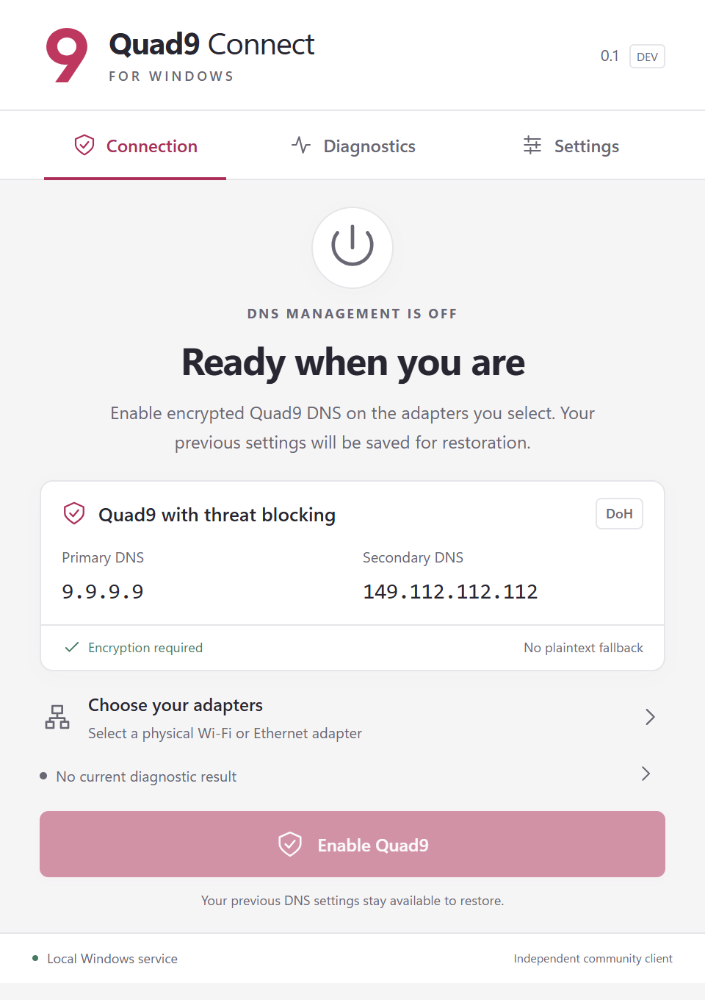
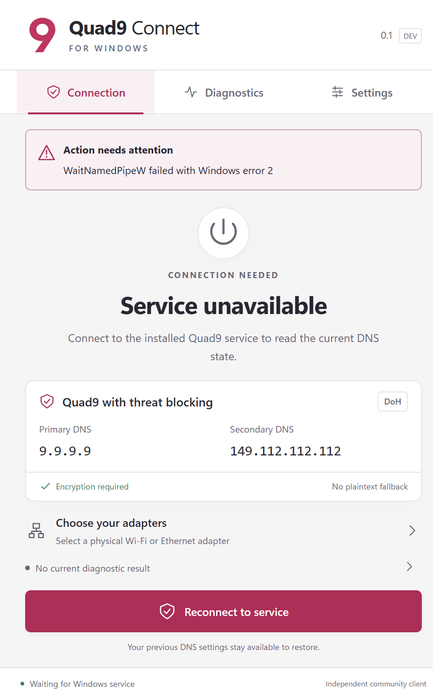
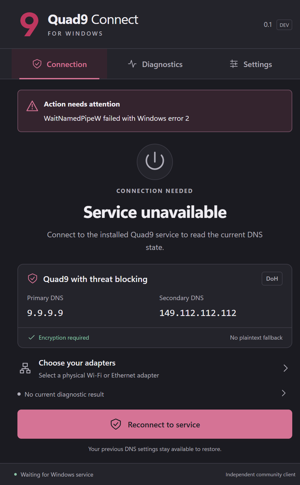
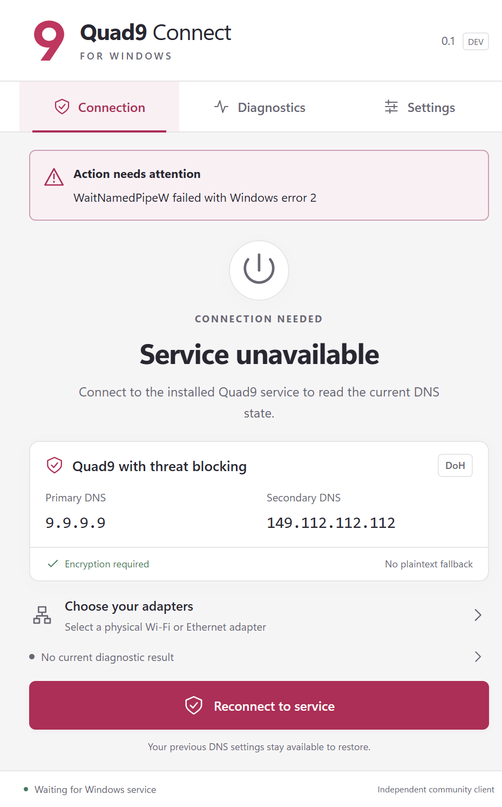
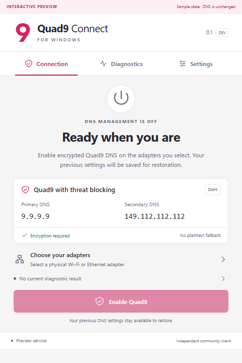
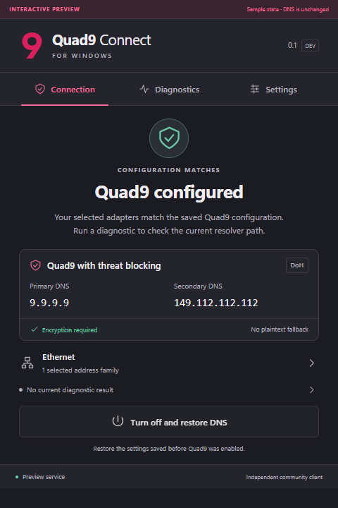
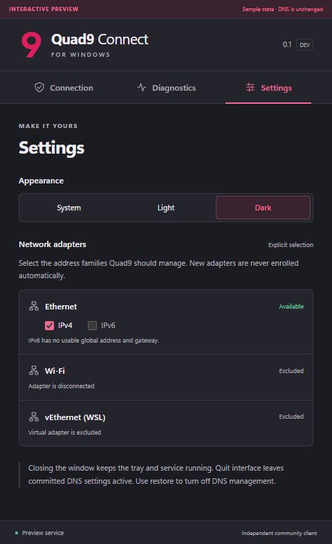
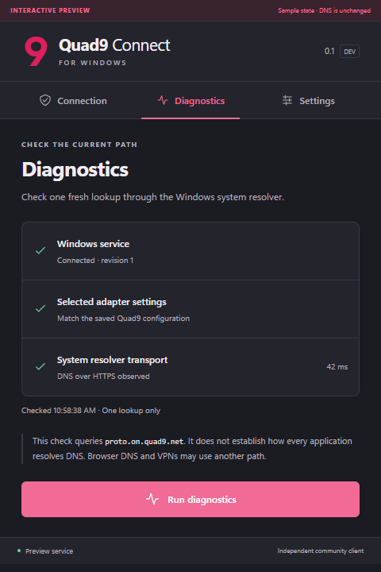
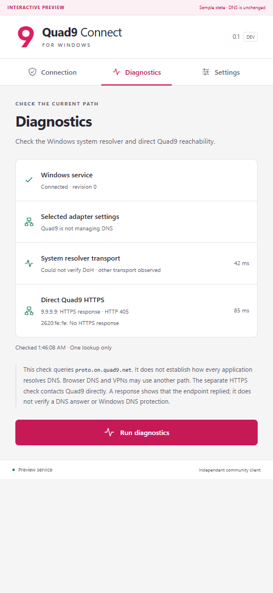
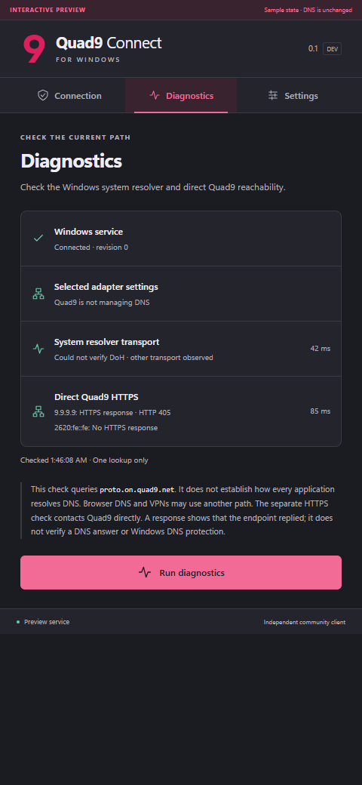

# Desktop UI screenshots

Native captures show the packaged Tauri app with embedded assets and real Rust IPC on Windows 11 Pro, build 10.0.26300. Browser captures show labeled sample states in Edge at 480 logical pixels wide. Playwright captures settled states after the corresponding interaction. Browser preview fixtures cannot activate in a production build.

## Native release after startup refresh fixes

This capture uses the packaged MSVC candidate from [PR #19](https://github.com/M0inUddin/quad9-connect-windows/pull/19), a fresh standard-user token enrolled by the real installer, and authenticated Rust IPC. DNS management is off and no adapters are selected. The [startup and resource record](../validation/windows11-26300-startup-window-resources.json) identifies its hashes and measurement scope.

## Native release client, authorized service

The real installer enrolled a temporary standard local account. A fresh token launched this packaged release client alongside the LocalSystem service, with DNS management off. It reached the authenticated "Ready when you are" state. The [combined resource record](../validation/windows11-26300-combined-resources.json) identifies the candidate and confirms safe cleanup with the original DNS baseline unchanged. This capture predates direct-upstream diagnostics.

## Native release client, service absent

These release-build captures use a fresh application profile and the standard-user token after the temporary service test completed and cleaned up. The client displays its real unavailable-service state. The application changes its own theme. Build hashes, display scaling, test scope, and cleanup results are recorded in the [Windows 11 validation record](../validation/windows11-26300-performance-accessibility.json).

## Earlier native smoke capture

This earlier native smoke capture used an absent service. The client displays its actual unavailable state, prevents Enable, and offers reconnect.

## Browser fixture, connection in the light theme

## Browser fixture, configured in the dark theme

## Browser fixture, settings in the dark theme

## Browser fixture, diagnostics in the dark theme

## Browser fixture, independent direct-upstream results

These Edge captures show a direct IPv4 HTTPS response alongside an unverified system resolver and an unreachable IPv6 endpoint. A response status establishes endpoint reachability only. The fixture does not perform network requests or change DNS settings.

To regenerate browser captures, run `npm run build` and `npm run test:e2e` in `apps/desktop`. Run `node scripts/native-validation.mjs <release-desktop.exe> 20 <output-directory>` unelevated for the native captures. Add `--require-service` only when the service is installed, the current token is authorized, and DNS management is off. `native-smoke.mjs` generates the earlier unavailable-service capture when the service is absent. Generated profiles and raw validation output stay under ignored directories. Only selected screenshots and sanitized validation records are tracked.
